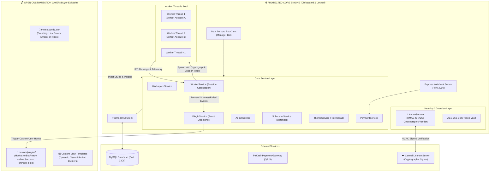
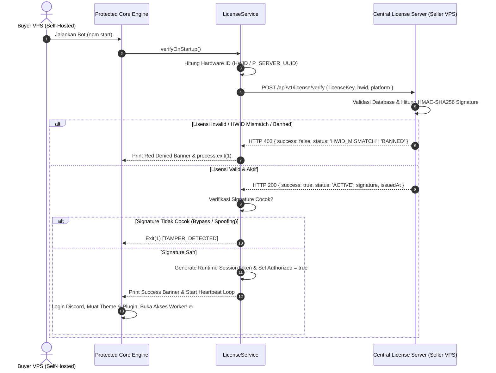

# 🏛️ System Architecture

Arsitektur aplikasi **Discord SelfBot Message Scheduler** dirancang dengan prinsip *separation of concerns*, *process isolation*, *dual-layer modular protection*, dan *cryptographic security*.

---

## 🏗️ High-Level System Architecture Diagram

---

## 🧩 Architectural Components Breakdown

### 1. Dual-Layer Modular Architecture (Open vs Protected)
Sistem memisahkan secara ketat antara **Protected Core** dan **Open Customization Layer**:
- **Open Customization Layer**:
  - `theme.config.json`: File konfigurasi JSON untuk mengubah nama bot, logo, GIF banner, warna embed (hex), emoji, dan judul antarmuka Discord secara bebas dan instan tanpa kompilasi ulang (hot-reload).
  - `custom/plugins/`: Folder modular bagi pembeli untuk menyematkan logika khusus (`onBotReady`, `onPostSuccess`, `onPostFailed`, dsb.).
  - `src/views/` (atau `dist/views/`): Template tampilan Discord yang dibiarkan terbuka dan dapat di-override.
- **Protected Core Engine**:
  - `services/license.service.ts`: Guardian lisensi yang memverifikasi tanda tangan digital HMAC-SHA256 dari Central License Server.
  - `services/worker.service.ts`: Pengelola Worker Thread yang mewajibkan otorisasi sesi sebelum mengeksekusi worker.
  - `workers/bot.worker.ts`: Eksekutor selfbot terisolasi dengan anti-tamper trap (menolak berjalan tanpa valid session token).
  - `utils/security.ts`: Enkripsi token AES-256.

### 2. Main Bot Process (`src/index.ts`)
- Mengontrol bot manager yang berinteraksi langsung dengan pelanggan melalui UI Discord (Buttons, Modals, Slash Commands, Select Menus).
- Menerima event discord, menginisialisasi `ThemeService` & `PluginService`, dan menangani graceful shutdown (SIGINT/SIGTERM).

### 3. Express HTTP Webhook Server (`src/api/`)
- Menjalankan endpoint lightweight `/api/webhook/payment` untuk menerima notifikasi callback instan dari PaKasir begitu pembayaran QRIS selesai.
- Menggunakan database transaction atomic (`prisma.$transaction`) untuk memastikan tidak terjadi double-spending / race condition.

### 4. Worker Threads Pool (`src/workers/bot.worker.ts`)
- Setiap task aktif dijalankan di dalam **Node.js Worker Thread** terpisah.
- **Isolasi Penuh**: Jika salah satu akun selfbot terkena error koneksi, token invalid, atau captcha dari Discord, worker tersebut dapat dihentikan tanpa mengganggu bot manager utama atau worker akun lain.
- **Komunikasi IPC**: Worker mengirimkan event status (`READY`, `SENT`, `ERROR`, `FATAL_AUTH`, `RATE_LIMIT`) ke parent process melalui pesan IPC standard `parentPort.postMessage()`.

### 5. Central License Server & Cryptographic Signer (`src/services/license.service.ts` & `license-server/`)
- **Cryptographic Anti-Tamper Signature**: Central License Server menghasilkan signature HMAC-SHA256 berdasarkan kombinasi `licenseKey + hwid + pteroUuid + status + expiryDate + timestamp` menggunakan master salt rahasia.
- **Client Signature Verification**: Bot memverifikasi keaslian signature server. Jika pengguna mencoba memalsukan respon lokal atau membypass kode, tanda tangan tidak cocok dan sistem otomatis memicu `TAMPER_DETECTED`.
- **Runtime Session Token Injection**: Worker Thread hanya dapat diluncurkan jika memiliki Session Token kriptografis aktif.
- **HWID & Pterodactyl Binding**: Mengunci lisensi secara permanen ke hardware VPS atau container Pterodactyl (`P_SERVER_UUID`).
- **Heartbeat Daemon**: Watchdog berkala yang memverifikasi lisensi di background setiap 30–60 menit.

---

## 🔑 License Verification Lifecycle (Dual-Layer Model)

