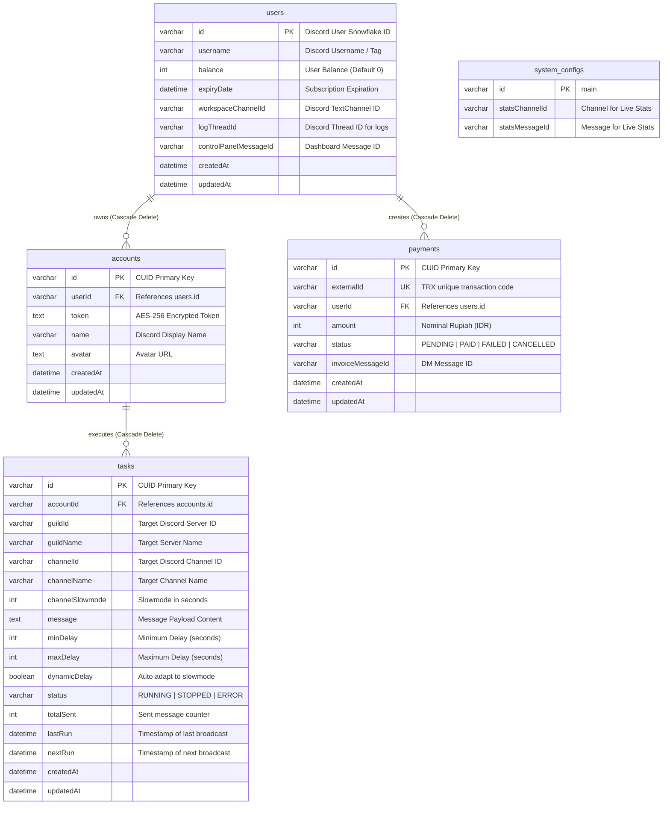

# 🗄️ Database Architecture & Schema (MySQL Edition)

Project ini menggunakan **MySQL** sebagai database relasional utama yang dikelola melalui **Prisma ORM** (`prisma/schema.prisma`).

---

## 📊 Entity Relationship & Data Flow

---

## 📑 Prisma Schema Details (MySQL Engine)

### 1. `users` Table
Menyimpan entitas pelanggan, status langganan, dan pointer Discord channel/thread milik pelanggan.
- **`id`**: String custom (Discord Snowflake ID).
- **`expiryDate`**: Waktu kedaluwarsa langganan. Jika `expiryDate < now()`, user kehilangan hak akses broadcast task.
- **`workspaceChannelId`**: ID channel privat di kategori `Workspaces`.
- **`logThreadId`**: ID thread log aktivitas di dalam channel privat.

### 2. `accounts` Table
Menyimpan kredensial akun selfbot yang didaftarkan oleh user.
- **`token`**: Text terenkripsi menggunakan AES-256 (`iv:encryptedData`).
- Relasi `onDelete: Cascade` memastikan jika User dihapus, seluruh Account miliknya ikut terhapus.

### 3. `tasks` Table
Mendefinisikan jadwal dan aturan pengiriman pesan otomatis.
- **`dynamicDelay`**: Boolean yang menentukan apakah bot otomatis mengikuti slowmode channel target.
- **`status`**: Status eksekusi (`RUNNING` jika worker aktif mengirim, `STOPPED` jika dipause oleh user).
- **`totalSent`**: Metrik kumulatif pesan berhasil dikirim.

### 4. `payments` Table
Menyimpan riwayat transaksi pembayaran QRIS via PaKasir.
- **`externalId`**: ID unik transaksi untuk referensi ke gateway pembayaran.
- **`status`**: Status transaksi (`PENDING`, `PAID`, `CANCELLED`, `FAILED`).

### 5. `system_configs` Table
Menyimpan konfigurasi singleton sistem (seperti pesan embed live stats server).
